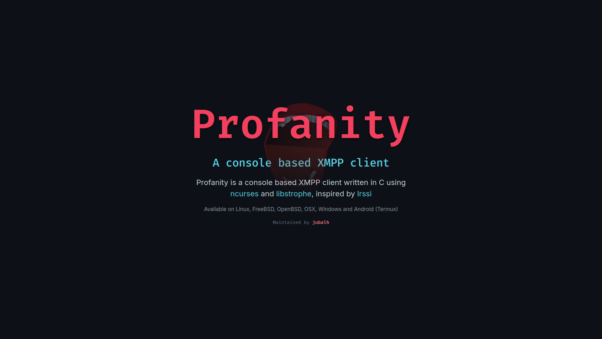

It was about time to give our website a visual overhaul. I hope the new design brings a cleaner and more modern look.

Along with the design refresh, I went through parts of the site to clean up outdated content. Pruning ancient FAQ entries and updating features. Quite a few sections are still in need of a polish and update (the [User Guide](../../guide/latest/userguide.html), for instance, is next on the list). I will continue working on these incrementally.

## RSS
Additionally, the blog now has a working [RSS Feed](../index.xml) available at:
`https://profanity-im.github.io/blog/index.xml`

Feel free to plug it into your favorite feed reader to stay up to date with future releases and development news.

### Before & After

Here is a look back at the previous design:

And here is the refreshed look:

Feedback, bug reports, and suggestions for the new site are always welcome via our [GitHub Issues](https://github.com/profanity-im/profanity-im.github.io/issues).

