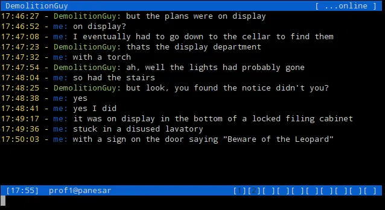
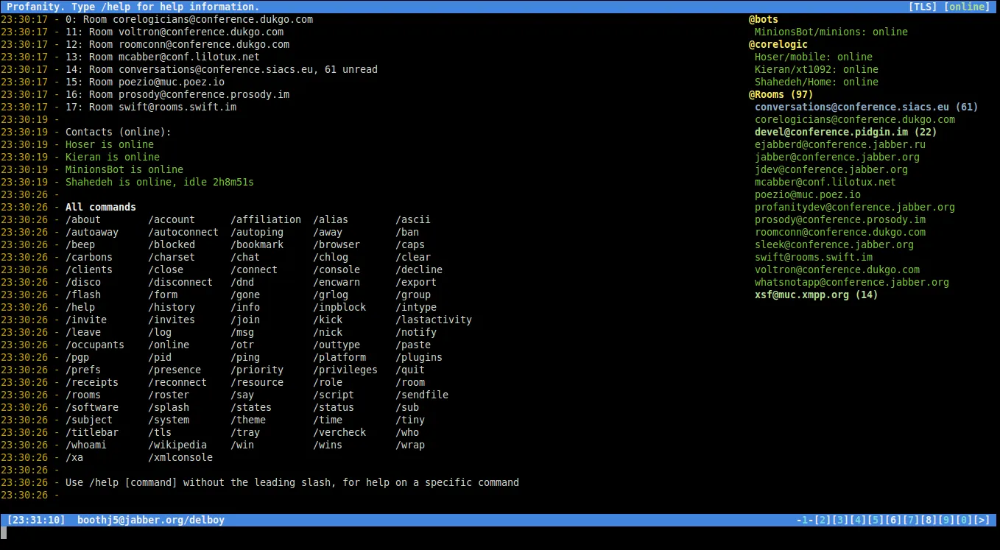
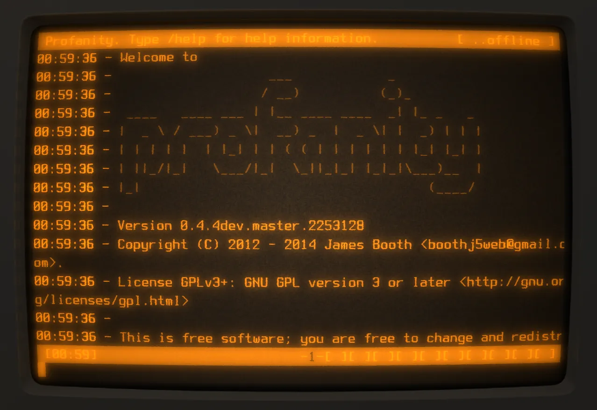
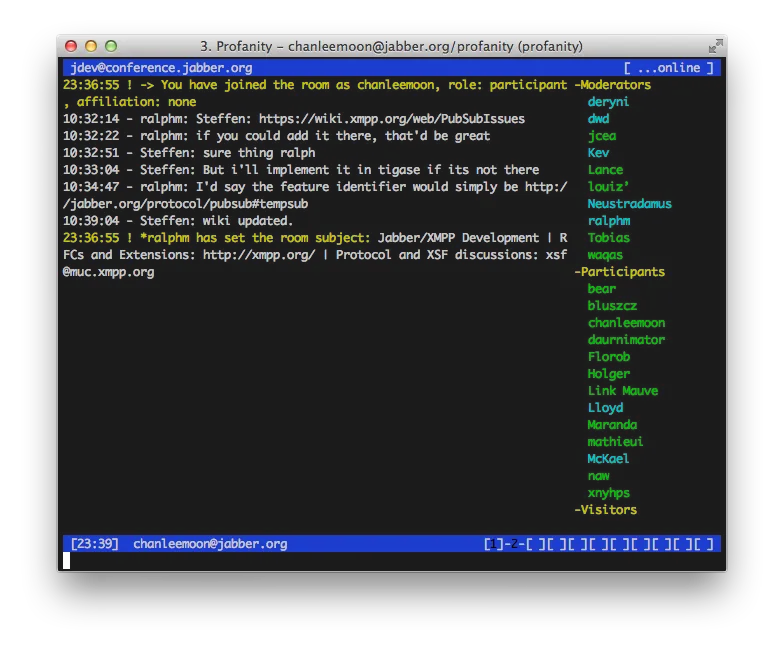
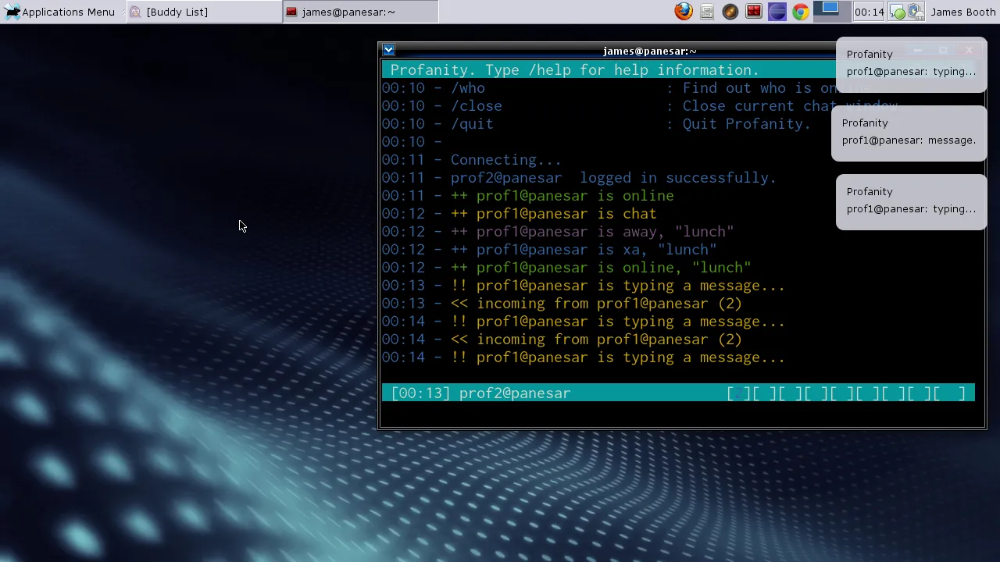
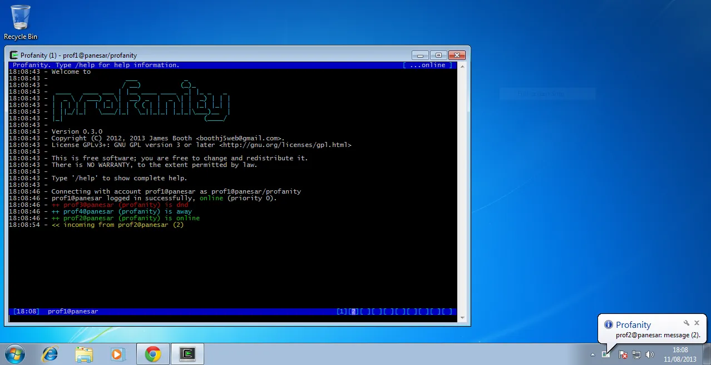
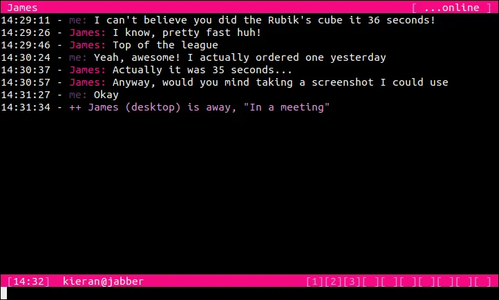
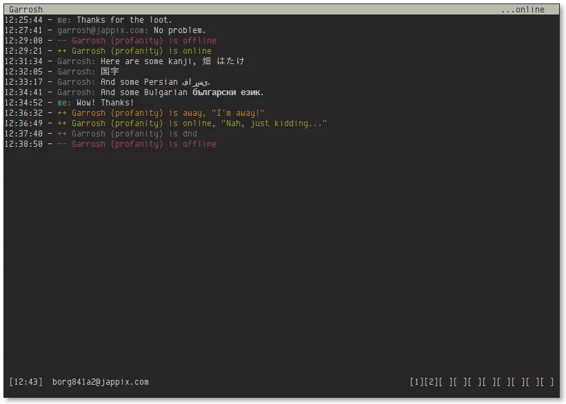

title: Profanity, a console based XMPP client - Home
subtitle: A console based XMPP client

${div_downloads}

&#9829; Enjoying Profanity? Consider <a href="donate.html">donating to support development</a>.

    <h3>Documentation</h3>
    <ul class="docs-directory">
        <li><a href="userguide.html">User Guide</a></li>
        <li><a href="faq.html">FAQ</a></li>
        <li><a href="xeps.html">Supported XEPs</a></li>
        <li><a href="plugins.html">Plugins</a></li>
        <li><a href="issues.html">Reporting Issues</a></li>
        <li><a href="helpout.html">How to Help Out</a></li>
        <li><a href="blog/post/index.html">Blog</a></li>
        <li><a href="themegallery.html">Theme Gallery</a></li>
    </ul>

    <h3>Download Profanity</h3>
    

        

            <a class="dl-link" href="tarballs/profanity-${version}.tar.xz">profanity-${version}.tar.xz</a>
            
sha256: ${tar_xz_sha256}

        

        

            <a class="dl-link" href="tarballs/profanity-${version}.zip">profanity-${version}.zip</a>
            
sha256: ${zip_sha256}

        

    

${div_end}

${div_features}

### Features

- Supports modern XMPP chat services
- Multi-User Chat (MUC) room support
- End-to-end Encryption: OMEMO, PGP, OX and OTR
- Multi-device sync: Message Carbons and Message Archive Management (MAM)
- File Sharing via HTTP File Upload
- Advanced messaging: Message Correction, Delivery Receipts, and Chat States
- Robust connections with Stream Management
- Theming and Consistent Color Generation
- Desktop notifications
- Extensible via plugins

${div_end}

${div_screenshots}

### Screenshots

- 
- 
- 
- 
- 
- 
- 
- 
- 

${div_end}
